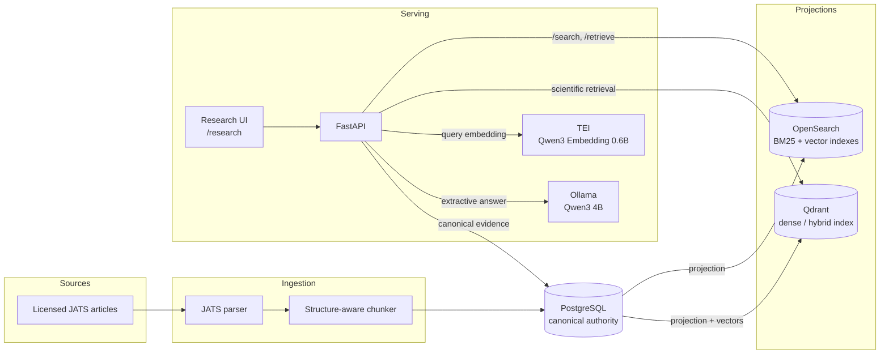
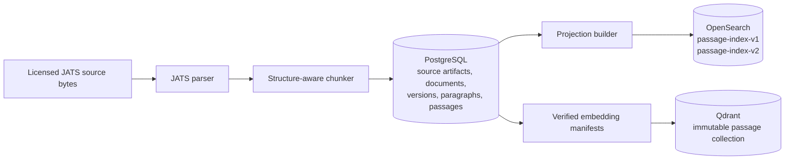
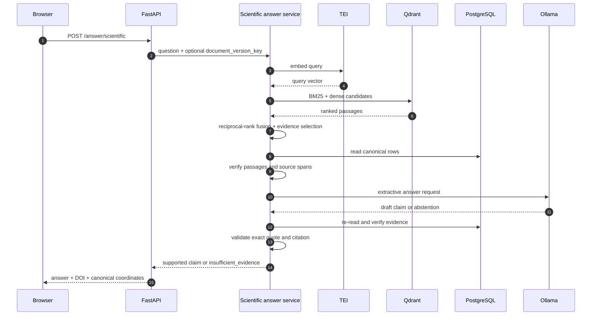

# Architecture

DynamisRAG separates canonical scientific state from rebuildable retrieval
projections. PostgreSQL owns the canonical record; OpenSearch and Qdrant are
caches that can be rebuilt from it. The browser talks only to the FastAPI
application, and the scientific answer path stays local.

## System context

The generic search and retrieval endpoints use the OpenSearch projection. The
scientific research path uses the Qdrant projection for BM25, dense candidates
and reciprocal-rank fusion, then reads and verifies the cited rows from
PostgreSQL. TEI embeds the query; Ollama produces only an extractive claim or an
explicit abstention.

## Ingestion and projection

Ingestion is deterministic: the same document version and chunker revision
produce the same passages and `passage_key`s. Source bytes, canonical rows and
projection identities are content-addressed. OpenSearch and Qdrant can be
deleted and rebuilt without changing the canonical record.

## Scientific answer request

A structurally invalid claim is rejected, and an unsupported question returns
`insufficient_evidence` instead of an answer. Citation checks prove that a
claim is copied from the cited span; they do not prove scientific entailment or
truth. See [testing and evidence boundaries](testing-and-evidence.md) for what
the recorded acceptance does and does not establish.

## Conversational scientific research agent (`/api/v2`)

For multi-turn scientific investigation, DynamisRAG exposes a stateful
10-node LangGraph orchestrator under `/api/v2` (see
[RES-637 conversational agent architecture](res637-conversational-agent-architecture.md)
and [RES-637 model qualification](res637-agent-qualification.md)):

- **Canonical read-only boundary**: all 10 scientific tools execute inside
  `REPEATABLE READ READ ONLY` transactions on canonical PostgreSQL tables while
  reading hybrid retrieval candidates from Qdrant and OpenSearch projections.
- **Isolated operational state**: conversation threads, run records, SSE event
  logs, and LangGraph checkpoints live in an isolated PostgreSQL schema
  (`agent_v2`) and never mutate canonical scientific tables.
- **Independent canonical verification**: provisional model claims are verified
  against `passage_source_span` character coordinates (`MODEL_PROPOSED`
  provenance) before any citation is emitted.

