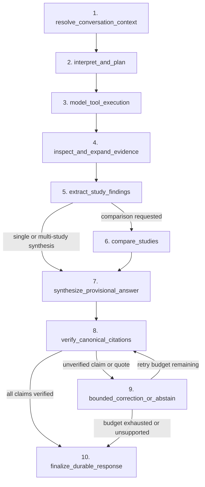

# ADR: Conversational Scientific Research Agent Architecture (RES-637)

- **Status:** Accepted
- **Issue:** RES-637
- **Target Package:** `dynamisrag.agent`
- **Canonical Authority Boundary:** PostgreSQL canonical tables remain the sole source of truth for scientific evidence and citations; conversational state and LangGraph checkpoints are isolated in a separate persistence boundary.

> **Repair update (PR #34, independent-review P1 fixes).** Sections 2.3–2.5 below were corrected;
> where this document and [`res637-eve-python-contract.md`](res637-eve-python-contract.md) disagree,
> the contract ADR wins. In short: identity is a signed server-side assertion (not a trusted header),
> runs are *enqueued* and executed by leased workers with live SSE from the persisted log, agent state
> must live in a **dedicated agent database** (never the canonical one), tool selection is made by the
> model and validated, citation verification is layered, LangSmith export is structure-only by default,
> and `OpenCode Go` is gated behind an unverified-usage-rights blocker. Eve (RES-638) owns the
> user-facing conversation; this Python service owns the bounded research run.

## 1. Context and Problem Statement

DynamisRAG v0.1 established deterministic JATS ingestion, content-addressed canonical storage in PostgreSQL, rebuildable OpenSearch and Qdrant retrieval projections, and a single-turn extractive scientific answer service (`/answer/scientific`).

DynamisRAG v0.2 (RES-637) requires a stateful, multi-turn conversational scientific research agent capable of:

1. Resolving conversational context across turns (such as pronouns, prior study sets, and follow-up filters) without elevating prior assistant turns to canonical evidence.
2. Planning and executing model-directed tool calls across 10 typed scientific tools.
3. Inspecting passages, expanding paragraph context within canonical sections, extracting structured `MODEL_PROPOSED` study findings, and comparing studies across methodological and outcome dimensions.
4. Enforcing deterministic statistical compatibility checks before computing summary statistics, mean differences, percentage changes, or Hedges' $g$.
5. Independently verifying every cited claim, verbatim quote, and numerical figure against canonical PostgreSQL source spans before emitting a supported response.
6. Providing durable thread state, run lifecycles, reconnectable Server-Sent Events (SSE), cancellation, interruption/resumption, user ownership isolation, and privacy-safe LangSmith evaluation.

## 2. Architectural Decisions

### 2.1 Explicit 10-Stage LangGraph Orchestration

Rather than an unconstrained ReAct loop or a single prompt chained to retrieval, `dynamisrag.agent.graph` implements a 10-node `StateGraph` with independent deterministic guards around model decisions:

| Stage | Node Name | Responsibility |
|---|---|---|
| 1 | `resolve_conversation_context` | Resolves references to prior turns (`these papers`, `those findings`, `depth jumping`) into explicit document version keys and search constraints while marking prior assistant messages as non-canonical context. |
| 2 | `interpret_and_plan` | Classifies question intent (`general_overview`, `specific_mechanism`, `cross_paper_comparison`, `follow_up_filter`, `statistical_analysis`, or `unsupported_scope`) and initializes run budgets. |
| 3 | `model_tool_execution` | Invokes the configured LangChain chat model bound to the permitted `StructuredTool` registry (`list_papers`, `hybrid_search`, `search_index`, `get_passage`, `expand_passage_context`, `get_study_metadata`, `extract_study_findings`, `compare_studies`, `calculate_statistics`, `verify_claims`) within strict tool-call, token, and latency budgets. |
| 4 | `inspect_and_expand_evidence` | Verifies retrieved passages against canonical PostgreSQL spans and invokes `expand_passage_context` or `get_study_metadata` when neighboring paragraph context or study identity is needed. |
| 5 | `extract_study_findings` | Produces structured `ProposedStudyFinding` records (`origin="MODEL_PROPOSED"`, `review_state="PROPOSED"`) anchored to exact canonical `passage_key`, `span_key`, `paragraph_key`, and character coordinates. |
| 6 | `compare_studies` | Executed conditionally when cross-paper comparison is requested; builds a `StudyComparisonMatrix` comparing study design, population, intervention, comparator, protocol, outcomes, and units, and classifies compatibility (`DIRECTLY_COMPARABLE`, `METHODOLOGICALLY_HETEROGENEOUS`, or `INCOMPATIBLE_OUTCOMES_OR_UNITS`). |
| 7 | `synthesize_provisional_answer` | Synthesizes a provisional grounded response with candidate claims and verbatim quotes linked to canonical passages. |
| 8 | `verify_canonical_citations` | Independently invokes `verify_claims` against canonical PostgreSQL rows to verify that every cited `passage_key`, `span_key`, verbatim quote, and numerical figure exists in the authoritative source span. |
| 9 | `bounded_correction_or_abstain` | Attempts at most one bounded repair removing or correcting unverified claims; if no verified claims remain, transitions deterministically to `insufficient_evidence` abstention. |
| 10 | `finalize_durable_response` | Persists the final turn state, provenance bundle, model/tool metrics, and terminal SSE event (`run.completed` or `run.abstained`). |

When `require_confirmation=true`, a side-effect-free `await_confirmation` node (a real LangGraph `interrupt()`) sits between planning and tool execution; the worker records the `interrupted` state and a resume re-queues the run with `Command(resume=...)`, in any process.

### 2.2 Scientific Tool Registry (`dynamisrag.agent.tools`)

All 10 scientific tools are implemented on `ScientificToolRegistry` and exposed both as direct typed Python methods and as LangChain `StructuredTool` bindings:

1. `list_papers`: Lists authorized canonical document versions and identifiers (`doi`, `pmid`, `pmcid`).
2. `hybrid_search`: Queries `ScientificRetrievalService` (Qdrant BM25 + dense RRF) when configured and falls back deterministically to canonical lexical + structural scoring over verified PostgreSQL rows.
3. `search_index`: Queries OpenSearch `Bm25SearchService` or `HybridRetrievalService` when configured and re-verifies every hit against canonical PostgreSQL.
4. `get_passage`: Loads a canonical passage with full `source_fingerprint` verification and paragraph span coordinates.
5. `expand_passage_context`: Retrieves neighboring body paragraphs (`before` / `after`) within the same document version and section.
6. `get_study_metadata`: Inspects canonical document version metadata, identifiers, license, section structure, and element counts.
7. `extract_study_findings`: Extracts `MODEL_PROPOSED` structured findings (`ProposedStudyFinding`) with verbatim sentences and exact character offsets.
8. `compare_studies`: Produces a structured `StudyComparisonMatrix` across two or more studies.
9. `calculate_statistics`: Performs deterministic calculations (`summary_stats`, `mean_difference`, `percentage_change`, `hedges_g_same_unit`) only after verifying identical normalized units, outcome names, and compatible protocols.
10. `verify_claims`: Independently verifies candidate claims, verbatim quotes, and numbers against canonical PostgreSQL spans and constructs a content-addressed `EvidenceSet` and `EvidenceGraph`.

External literature discovery (`discover_external_literature`) is disabled by default (`allow_external_discovery=False`) and never writes to canonical PostgreSQL tables, OpenSearch indexes, or Qdrant collections.

### 2.3 Isolated, Durable Conversational Persistence (`dynamisrag.agent.persistence`)

To preserve the canonical database schema invariant enforced by [testing and evidence boundaries](testing-and-evidence.md), conversational state is isolated from canonical scientific tables:

- Canonical scientific tables remain read-only (`SET TRANSACTION ISOLATION LEVEL REPEATABLE READ READ ONLY`) during all agent tool calls.
- Threads (`agent_threads`), runs (`agent_runs`), ordered events (`agent_run_events`) and LangGraph checkpoints (`PostgresSaver`) live in a **dedicated agent database** (`DYNAMISRAG_AGENT_DATABASE_URL`). Startup **fails closed** if that target is the protected canonical database (normalised host/port/database comparison plus a live server fingerprint). Durable operation requires it; the in-memory store is refused in `staging`/`production`.
- The database, not application code, enforces the invariants: `UNIQUE (thread_id, idempotency_key)`, a **partial unique index** allowing one active (`queued|running|interrupted`) run per thread, atomic `FOR UPDATE SKIP LOCKED` claims, database-clock leases with worker-fenced terminal writes, a per-run event counter that keeps `seq` gapless, and terminal status + terminal event committed in one transaction.
- Every thread and run query enforces `owner_id` scoping, where the owner is the **verified** identity (see the contract ADR), so a user cannot read, stream, cancel or resume another user's thread or run.
- Operational note: LangGraph checkpoints grow without bound; schedule a retention job before production.

### 2.4 Model Provider Abstraction (`dynamisrag.agent.providers`, `tool_loop`, `synthesis`)

`dynamisrag.agent.providers` provides a unified LangChain model factory supporting:

- Local Ollama (`ChatOllama`, e.g., `qwen3:4b`) using Ollama's **native structured tool-calling**.
- OpenAI-compatible endpoints (`ChatOpenAI`) and Anthropic (`ChatAnthropic`).
- `opencode_go` (OpenAI-compatible): **refused unless `DYNAMISRAG_AGENT_OPENCODE_GO_USAGE_APPROVED=true`**. OpenCode Go is documented as "designed for OpenCode and other coding agents"; use for a public scientific assistant is unverified (see the contract ADR). Contributor models that train on request data are refused outright.
- A deterministic scripted model for unit/CI tests. It is a test double, never a model qualification.

Tool choice is made by the model via `bind_tools`. `tool_loop` validates every requested call (allow-list, typed arguments, authorised version scope); invalid calls are `tool.rejected` events and never executed; the graph's own retrieval runs only as an explicit, reasoned `fallback.applied`. Each call is labelled `model_directed`, `graph_fallback` or `graph_enforced` in events and telemetry. The synthesis prompt carries the full question, prior turns, constraints, comparison and verbatim evidence with no truncation; unusable model output uses a labelled extractive fallback.

Every model invocation records provider, model identifier and revision, token counts, latency and estimated cost per run (telemetry is keyed by run id so concurrent runs cannot mix).

> **Update:** the production model layer is the three-role OpenCode Go roster described in
> [`res637-model-routing.md`](res637-model-routing.md); the single-model providers below remain
> for local development and tests.

### 2.5 LangSmith Tracing and Privacy Policy (`dynamisrag.agent.observability`)

- Tracing is **off** unless `DYNAMISRAG_AGENT_LANGSMITH_TRACING_ENABLED=true` *and* `DYNAMISRAG_AGENT_LANGSMITH_API_KEY` is set (enabling without a key is a startup error). `TracingPolicy.off()` wraps every run in `tracing_context(enabled=False)`, which overrides ambient `LANGSMITH_TRACING`.
- Default mode `structure_only` exports shapes and counts only: no question, article text, answer, tool output, reasoning or credential. Metadata (thread/run/worker ids) is hidden in every mode. `redacted_content` is opt-in and scrubs credentials, DSN passwords, e-mail, reasoning fields and `<think>` blocks.
- Redaction is verified against the bytes a real `langsmith.Client` transmits for a real LangGraph run, with a positive control proving the harness would detect a leak.
- Offline and CI evaluation run without LangSmith connectivity. Evaluation methodology v2: [`res637-agent-evaluation-v2.md`](res637-agent-evaluation-v2.md).
