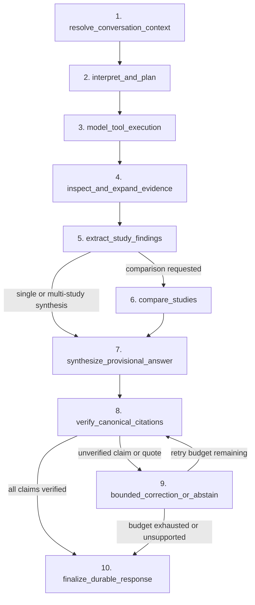

# ADR: Conversational Scientific Research Agent Architecture (RES-637)

- **Status:** Accepted
- **Issue:** RES-637
- **Target Package:** `dynamisrag.agent`
- **Canonical Authority Boundary:** PostgreSQL canonical tables remain the sole source of truth for scientific evidence and citations; conversational state and LangGraph checkpoints are isolated in a separate persistence boundary.

## 1. Context and Problem Statement

DynamisRAG v0.1 established deterministic JATS ingestion, content-addressed canonical storage in PostgreSQL, rebuildable OpenSearch and Qdrant retrieval projections, and a single-turn extractive scientific answer service (`/answer/scientific`).

DynamisRAG v0.2 (RES-637) requires a stateful, multi-turn conversational scientific research agent capable of:

1. Resolving conversational context across turns (such as pronouns, prior study sets, and follow-up filters) without elevating prior assistant turns to canonical evidence.
2. Planning and executing model-directed tool calls across 10 typed scientific tools.
3. Inspecting passages, expanding paragraph context within canonical sections, extracting structured `MODEL_PROPOSED` study findings, and comparing studies across methodological and outcome dimensions.
4. Enforcing deterministic statistical compatibility checks before computing summary statistics, mean differences, percentage changes, or Hedges' $g$.
5. Independently verifying every cited claim, verbatim quote, and numerical figure against canonical PostgreSQL source spans before emitting a supported response.
6. Providing durable thread state, run lifecycles, reconnectable Server-Sent Events (SSE), cancellation, interruption/resumption, user ownership isolation, and privacy-safe LangSmith evaluation.

## 2. Architectural Decisions

### 2.1 Explicit 10-Stage LangGraph Orchestration

Rather than an unconstrained ReAct loop or a single prompt chained to retrieval, `dynamisrag.agent.graph` implements a 10-node `StateGraph` with independent deterministic guards around model decisions:

| Stage | Node Name | Responsibility |
|---|---|---|
| 1 | `resolve_conversation_context` | Resolves references to prior turns (`these papers`, `those findings`, `depth jumping`) into explicit document version keys and search constraints while marking prior assistant messages as non-canonical context. |
| 2 | `interpret_and_plan` | Classifies question intent (`general_overview`, `specific_mechanism`, `cross_paper_comparison`, `follow_up_filter`, `statistical_analysis`, or `unsupported_scope`) and initializes run budgets. |
| 3 | `model_tool_execution` | Invokes the configured LangChain chat model bound to the permitted `StructuredTool` registry (`list_papers`, `hybrid_search`, `search_index`, `get_passage`, `expand_passage_context`, `get_study_metadata`, `extract_study_findings`, `compare_studies`, `calculate_statistics`, `verify_claims`) within strict tool-call, token, and latency budgets. |
| 4 | `inspect_and_expand_evidence` | Verifies retrieved passages against canonical PostgreSQL spans and invokes `expand_passage_context` or `get_study_metadata` when neighboring paragraph context or study identity is needed. |
| 5 | `extract_study_findings` | Produces structured `ProposedStudyFinding` records (`origin="MODEL_PROPOSED"`, `review_state="PROPOSED"`) anchored to exact canonical `passage_key`, `span_key`, `paragraph_key`, and character coordinates. |
| 6 | `compare_studies` | Executed conditionally when cross-paper comparison is requested; builds a `StudyComparisonMatrix` comparing study design, population, intervention, comparator, protocol, outcomes, and units, and classifies compatibility (`DIRECTLY_COMPARABLE`, `METHODOLOGICALLY_HETEROGENEOUS`, or `INCOMPATIBLE_OUTCOMES_OR_UNITS`). |
| 7 | `synthesize_provisional_answer` | Synthesizes a provisional grounded response with candidate claims and verbatim quotes linked to canonical passages. |
| 8 | `verify_canonical_citations` | Independently invokes `verify_claims` against canonical PostgreSQL rows to verify that every cited `passage_key`, `span_key`, verbatim quote, and numerical figure exists in the authoritative source span. |
| 9 | `bounded_correction_or_abstain` | Attempts at most one bounded repair removing or correcting unverified claims; if no verified claims remain, transitions deterministically to `insufficient_evidence` abstention. |
| 10 | `finalize_durable_response` | Persists the final turn state, provenance bundle, model/tool metrics, and terminal SSE event (`run.completed` or `run.abstained`). |

### 2.2 Scientific Tool Registry (`dynamisrag.agent.tools`)

All 10 scientific tools are implemented on `ScientificToolRegistry` and exposed both as direct typed Python methods and as LangChain `StructuredTool` bindings:

1. `list_papers`: Lists authorized canonical document versions and identifiers (`doi`, `pmid`, `pmcid`).
2. `hybrid_search`: Queries `ScientificRetrievalService` (Qdrant BM25 + dense RRF) when configured and falls back deterministically to canonical lexical + structural scoring over verified PostgreSQL rows.
3. `search_index`: Queries OpenSearch `Bm25SearchService` or `HybridRetrievalService` when configured and re-verifies every hit against canonical PostgreSQL.
4. `get_passage`: Loads a canonical passage with full `source_fingerprint` verification and paragraph span coordinates.
5. `expand_passage_context`: Retrieves neighboring body paragraphs (`before` / `after`) within the same document version and section.
6. `get_study_metadata`: Inspects canonical document version metadata, identifiers, license, section structure, and element counts.
7. `extract_study_findings`: Extracts `MODEL_PROPOSED` structured findings (`ProposedStudyFinding`) with verbatim sentences and exact character offsets.
8. `compare_studies`: Produces a structured `StudyComparisonMatrix` across two or more studies.
9. `calculate_statistics`: Performs deterministic calculations (`summary_stats`, `mean_difference`, `percentage_change`, `hedges_g_same_unit`) only after verifying identical normalized units, outcome names, and compatible protocols.
10. `verify_claims`: Independently verifies candidate claims, verbatim quotes, and numbers against canonical PostgreSQL spans and constructs a content-addressed `EvidenceSet` and `EvidenceGraph`.

External literature discovery (`discover_external_literature`) is disabled by default (`allow_external_discovery=False`) and never writes to canonical PostgreSQL tables, OpenSearch indexes, or Qdrant collections.

### 2.3 Isolated Conversational Persistence (`dynamisrag.agent.persistence`)

To preserve the canonical database schema invariant enforced by [testing and evidence boundaries](testing-and-evidence.md), conversational state is strictly isolated from canonical scientific tables:

- Canonical scientific tables remain read-only (`SET TRANSACTION ISOLATION LEVEL REPEATABLE READ READ ONLY`) during all agent tool calls.
- Conversational threads (`agent_threads`), runs (`agent_runs`), ordered SSE events (`agent_run_events`), and LangGraph checkpoints (`PostgresSaver` tables) are stored in an isolated PostgreSQL schema/database (or an isolated in-memory store when running unit tests without an external agent database).
- Every thread and run query enforces `owner_id` scoping at the persistence boundary so a user cannot read, stream, cancel, or resume another user's thread or run.

### 2.4 Model Provider Abstraction (`dynamisrag.agent.providers`)

`dynamisrag.agent.providers` provides a unified LangChain model factory supporting:

- Local Ollama (`ChatOllama`, e.g., `qwen3:4b` on the isolated Research Edition container).
- OpenAI-compatible tool-calling endpoints (`ChatOpenAI`).
- Anthropic tool-calling endpoints (`ChatAnthropic`).
- Deterministic structured evaluation adapters for reproducible unit and CI testing.

Every model invocation records provider name, model identifier, model digest/revision, prompt/completion token counts, latency, and estimated cost in the run provenance record.

### 2.5 LangSmith Tracing and Privacy Policy (`dynamisrag.agent.langsmith_eval`)

- LangSmith tracing is **disabled by default** (`DYNAMISRAG_AGENT_LANGSMITH_ENABLED=false`) so local scientific queries never leave the host unless explicitly opted in.
- When enabled, a deterministic redaction processor strips API keys, bearer tokens, database credentials, user identifiers, and configurable raw source text before any trace payload is exported.
- Offline and CI evaluation suites run deterministically without requiring external LangSmith network connectivity.
